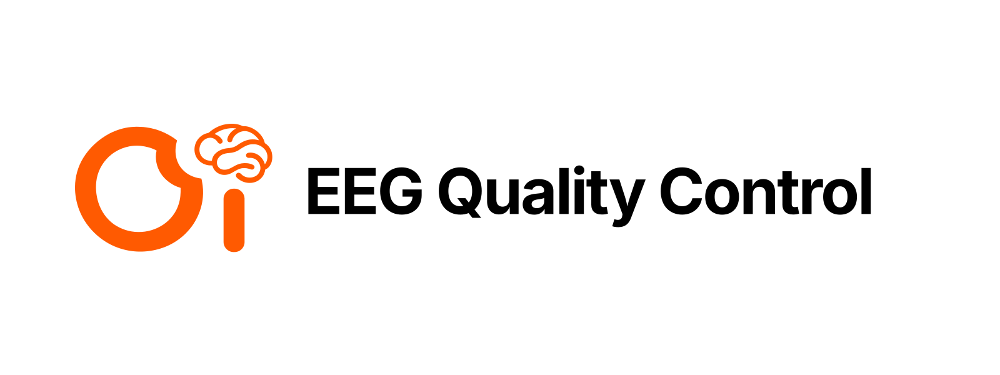
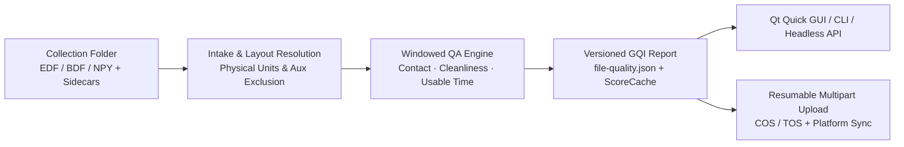

<p align="center">
  
</p>

<p align="center">
  <strong>English</strong> &nbsp; / &nbsp; <a href="README.zh-CN.md">简体中文</a>
</p>

<p align="center">
  <strong>Local-first EEG quality control, signal review, and resumable collection intake</strong>
</p>

<p align="center">
  <code>OI-EEGQC</code> unifies desktop quality inspection, headless acquisition handoff, CLI batch scoring, and resumable cloud intake on a single numerical engine and versioned report schema.
</p>

<p align="center">
  
  &nbsp;
  
  &nbsp;
  
  &nbsp;
  
  &nbsp;
  
</p>

<p align="center">
  <a href="#quick-start"><strong>Get started</strong></a> &nbsp; / &nbsp;
  <a href="https://github.com/Omni-Intel/oi-eegqc/releases/latest/download/OI-EEGQC-Setup-Windows-x64.exe">Windows installer</a> &nbsp; / &nbsp;
  <a href="https://github.com/Omni-Intel/oi-eegqc/releases/latest/download/OI-EEGQC-Windows-x64.zip">Portable zip</a> &nbsp; / &nbsp;
  <a href="docs/external-acquisition.md">External acquisition contract</a> &nbsp; / &nbsp;
  <a href="docs/scoring.md">Scoring model</a>
</p>

---

## Quick Start

**Windows Desktop:** Download the [Windows installer (`OI-EEGQC-Setup-Windows-x64.exe`)](https://github.com/Omni-Intel/oi-eegqc/releases/latest/download/OI-EEGQC-Setup-Windows-x64.exe) or the [portable archive (`OI-EEGQC-Windows-x64.zip`)](https://github.com/Omni-Intel/oi-eegqc/releases/latest/download/OI-EEGQC-Windows-x64.zip), or install silently from PowerShell:

```powershell
powershell -NoProfile -ExecutionPolicy Bypass -File scripts/install-desktop.ps1
```

**Command Line & Python API:**

```bash
python -m pip install -e '.[mne]'

oi-eegqc score -i recording.edf -o report.json
oi-eegqc score -i session_01 --sfreq 250 --unit uV -o batch-report.json
oi-eegqc --json datasets
oi-eegqc serve --stdio
```

Drop a collection folder, BIDS session, `.edf`, `.bdf`, or `.npy` file onto the window to inspect channel-level evidence and Global Quality Index (GQI), then upload the verified collection to project storage.

> [!NOTE]
> `OI-EEGQC` decouples UI responsiveness from numerical scoring and cloud transfer. Scoring and headless capture handoff (`--capture-complete-request`) run in isolated worker processes and persist durable `file-quality.json` and `upload-result.json` receipts—closing the window never corrupts or discards an completed background upload.

## What It Shows & Supported Inputs

| Input / View | Metadata Source | Behavior |
| --- | --- | --- |
| **EDF / EDF+ / BDF / BDF+** | File header & optional BIDS `_eeg.json` / `_channels.tsv` | Reads recorded sampling rate, physical units, and channel labels; automatically excludes auxiliary EOG/ECG/EMG/Trigger channels from EEG denominator |
| **NPY + Sidecar** | `<stem>.json`, `metadata.json`, or explicit prompt | Resolves `sfreq`, `unit`, `channels_first`, `channel_names`, or `channel_layout`; never invents missing calibration |
| **Collection Folder** | Recursive BIDS / session discovery | Scores all supported EEG files, reuses cached reports (`file-quality.json`), and retains stimulus logs, photos, and metadata for atomic folder upload |
| **Shared Record Hub** | `%LOCALAPPDATA%\Omni-Intelligence\records.sqlite` | Synchronizes session status (`已上传` / `正在上传` / `待重试`) with AV Capture; supports drag-and-drop auto-restore and one-click recovery of cleared lists |

<details>
<summary>Built-in Channel Layouts & Acquisition Profiles</summary>

| Layout ID | Channels | Device Aliases | Notes |
| --- | --- | --- | --- |
| `bcigo_sdk_1.0.2` | 32 (`31 EEG + 1 EOG IO`) | `bcigo`, `brainco` | Native EDF label order in `bcigo-sdk 1.0.2`; `EOG IO` excluded from EEG quality scoring |
| `omnibci_32_channel` | 32 (`31 EEG + 1 EOG IO`) | `omnibci 32 channel`, `omnibci32`, `omnibci` | 10-20 standard montage for STM32 + 4x ADS1299 (250 Hz, USB/Dongle serial & E73 BLE) |
| `neuracle_things_65` | 65 (`63 EEG + 2 Aux`) | `neuracle`, `borekam` | Neuracle 65-channel montage with auxiliary trigger/reference exclusion |

External acquisition programs can integrate via the [storage and import contract](docs/external-acquisition.md) and [metadata templates](examples/external-acquisition).

</details>

## Desktop Workflow & Controls

| Action | Operation | Behavior |
| --- | --- | --- |
| **Import Files / Folders** | Drag & drop or click `文件 / ZIP` · `选择文件夹` | Imports recordings or session folders; dropping a single `.edf` inside a session automatically attaches its parent session metadata for upload |
| **Restore Cleared List** | Click `恢复已清空 (N)` or drag files back in | Immediately restores records previously cleared from the shared list (`removed=0`) without re-scoring |
| **Score (`评分`)** | Click `评分` or select channel subset in `通道` | Runs windowed signal inspection in an isolated subprocess; reuses `ScoreCache` and `file-quality.json` when file fingerprint and parameters match |
| **Inspect Report (`报告`)** | Double-click row or click `查看` | Opens operator-friendly diagnostic breakdown: 5 dimension cards, channel-by-channel fault notes (`死导`, `幅度越界`, `工频干扰`, `高频噪声`), and window metrics |
| **Upload (`上传`)** | Click `上传` | Performs manifest diffing, multipart resumable COS/TOS upload, SHA-256 verification, and server-side `_COMPLETE` sealing |
| **Check Update (`检查更新`)** | Click `检查更新` | Verifies SHA-256 digest against the release manifest and applies in-place portable or installer updates |

## Quality Model (GQI)

The current report format is schema v3, scoring algorithm `oi-eegqc-score-v7`, and default threshold profile `oi-eegqc-v0.6.14`. Every report records the exact algorithm version and active configuration.

| Dimension | Default Weight | What It Evaluates |
| --- | --- | --- |
| **Contact (`接触`)** | `0.20` | Dead/flat channels, detached leads, spatial neighbor decoupling (`corr_threshold`), and optional impedance |
| **Cleanliness (`洁净`)** | `0.30` | High-frequency noise-to-signal ratio (`55–95 Hz` vs `1–45 Hz`), `50/60 Hz` mains line interference, and amplitude excursions |
| **Usable Time (`时长评分`)** | `0.30` | Fraction of overlapping 2-second windows passing channel-level gates, mapped against duration-adaptive cutoffs |
| **Integrity (`完整性`)** | `0.10` | Channel completeness, finite samples, and recording duration consistency (when expected metadata is supplied) |
| **Stimulus Sync (`刺激同步`)** | `0.10` | Event marker completeness and presentation clock drift (evaluated only when stimulus events are provided) |

<details>
<summary>Scoring boundaries and plateau rules</summary>

- **Quality vs. cognitive state:** GQI measures physical recording quality for acquisition review and dataset intake. It does not infer cognition, attention, clinical diagnosis, or the physiological origin of an artifact.
- **Auxiliary channel handling:** Auxiliary channels (`EOG IO`, `ECG`, `EMG`, `TRIGGER`, `STI 014`) are excluded before scoring. Dead or flat *EEG* channels are deliberately kept in the denominator and penalized by the flat-amplitude gate so a recording with dead electrodes cannot achieve a high score.
- **Extrema plateaus:** Local extrema plateaus in unfiltered windows are reported for operator review; quantization alone can produce short plateaus, so only sustained rail-clipping triggers hard-fail gates. See [scoring rules and limitations](docs/scoring.md).

</details>

## How It Works



<details>
<summary>Project Structure</summary>

```text
assets/oi-eegqc-hero.svg       Brand hero banner and Omni-Intelligence icons
src/oi_eegqc/quick.py          Qt Quick / PySide6 desktop controller and QML bindings
src/oi_eegqc/qml/              Declarative UI views, report sheet, channel selector, upload sheet
src/oi_eegqc/intake.py         File discovery, physical unit normalization, sidecar & BIDS parsing
src/oi_eegqc/layouts/          YAML electrode layouts (BCIGO 32ch, OmniBCI 32ch, Neuracle 65ch)
src/oi_eegqc/pipeline.py       Zero-phase preprocessing and windowed QA orchestration
src/oi_eegqc/qa/               Window-level detectors (amplitude, NSR, line noise, clipping)
src/oi_eegqc/scoring/          GQI aggregation, letter grades, and plain-language operator notes
src/oi_eegqc/capture_service.py Headless one-stop scoring + upload handoff for AV Capture
src/oi_eegqc/upload_session.py Resumable multipart uploader, manifest diffing, and sealing
src/oi_eegqc/record_bridge.py  Shared SQLite record hub synchronization and auto-recovery
```

</details>

## Development

```bash
python -m venv .venv
python -m pip install -e '.[desktop,dev,packaging]'
pytest
python scripts/check.py --calibrate
```

On Windows, `scripts/build-desktop.ps1` runs the test suite, fault-injection calibration, PyInstaller packaging, frozen-binary smoke verification (`scripts/smoke-desktop.py`), and Inno Setup installer generation.

- [Architecture and module ownership](docs/architecture.md)
- [Scoring rules and limitations](docs/scoring.md)
- [Desktop operation guide](docs/desktop.md)
- [Windows build and release](docs/windows-app.md)
