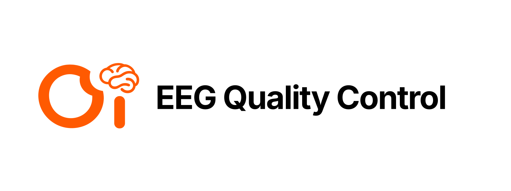
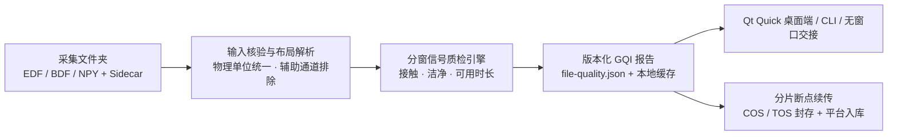

<p align="center">
  
</p>

<p align="center">
  <a href="README.md">English</a> &nbsp; / &nbsp; <strong>简体中文</strong>
</p>

<p align="center">
  <strong>面向脑电采集质控、信号复核与断点续传归档的本地优先工具</strong>
</p>

<p align="center">
  <code>OI-EEGQC</code> 将桌面端交互式质检、采集端无窗口后台交接、CLI 批量评分与云端断点直传统一在同一套数值引擎与版本化报告格式之上，做到直观易排查、评分可复现、传输可恢复。
</p>

<p align="center">
  
  &nbsp;
  
  &nbsp;
  
  &nbsp;
  
  &nbsp;
  
</p>

<p align="center">
  <a href="#快速开始"><strong>快速开始</strong></a> &nbsp; / &nbsp;
  <a href="https://github.com/Omni-Intel/oi-eegqc/releases/latest/download/OI-EEGQC-Setup-Windows-x64.exe">Windows 安装包</a> &nbsp; / &nbsp;
  <a href="https://github.com/Omni-Intel/oi-eegqc/releases/latest/download/OI-EEGQC-Windows-x64.zip">便携版压缩包</a> &nbsp; / &nbsp;
  <a href="docs/external-acquisition.zh-CN.md">外部采集接入规范</a> &nbsp; / &nbsp;
  <a href="docs/scoring.md">评分模型</a>
</p>

---

## 快速开始

**Windows 桌面端：** 直接下载 [Windows 安装包 (`OI-EEGQC-Setup-Windows-x64.exe`)](https://github.com/Omni-Intel/oi-eegqc/releases/latest/download/OI-EEGQC-Setup-Windows-x64.exe) 或 [便携版压缩包 (`OI-EEGQC-Windows-x64.zip`)](https://github.com/Omni-Intel/oi-eegqc/releases/latest/download/OI-EEGQC-Windows-x64.zip)，也可在 PowerShell 中静默安装：

```powershell
powershell -NoProfile -ExecutionPolicy Bypass -File scripts/install-desktop.ps1
```

**命令行与自动化接口：**

```bash
python -m pip install -e '.[mne]'

oi-eegqc score -i recording.edf -o report.json
oi-eegqc score -i session_01 --sfreq 250 --unit uV -o batch-report.json
oi-eegqc --json datasets
oi-eegqc serve --stdio
```

将采集文件夹、BIDS 目录、`.edf`、`.bdf` 或 `.npy` 直接拖入窗口，即可在本地查看综合质量分（GQI）、可用时间窗占比与逐导联诊断建议，确认后一键整夹上传归档。

> [!NOTE]
> `OI-EEGQC` 将界面生命周期与后台评测/上传子进程解耦。采集端后台交接（`--capture-complete-request`）生成的整轮评分（`file-quality.json`）与上传回执（`upload-result.json`）落盘即生效——打开桌面窗口会 0 秒直接复用已有结果，不会重复重评历史 Session 或锁死上传按钮。

## 支持格式与设备布局

| 输入与视图 | 参数来源 | 处理行为 |
| --- | --- | --- |
| **EDF / EDF+ / BDF / BDF+** | 文件头与可选 BIDS `_eeg.json` / `_channels.tsv` | 自动读取采样率、物理单位与通道标签；自动识别并排除 `EOG IO`、心电、肌电、Trigger 等辅助通道，避免污染脑电评分分母 |
| **NPY + Sidecar** | `<stem>.json`、`metadata.json` 或弹窗补充 | 解析 `sfreq`、`unit`、`channels_first`、`channel_names` 或 `channel_layout`；不凭空捏造缺失标定 |
| **采集文件夹** | 递归扫描 BIDS / Session 目录 | 复用已有 `file-quality.json` 与评分缓存，保留刺激事件、阻抗截图、视频等辅助文件一并校验上传 |
| **本机公共记录名单** | `%LOCALAPPDATA%\Omni-Intelligence\records.sqlite` | 与 AV Capture 实时同步 `完成 · 已上传`、`正在上传`、`上传待重试` 状态；支持清空后拖入自动恢复与顶部一键「恢复已清空」 |

<details>
<summary>内置电极布局与采集设备适配</summary>

| 布局 ID | 通道数 | 设备代号 / 别名 | 说明 |
| --- | --- | --- | --- |
| `bcigo_sdk_1.0.2` | 32 (`31 EEG + 1 EOG IO`) | `bcigo`, `brainco` | 强脑 `bcigo-sdk 1.0.2` 原生 EDF 通道序，第 29 路 `EOG IO` 作为眼电辅助通道自动排除 |
| `omnibci_32_channel` | 32 (`31 EEG + 1 EOG IO`) | `omnibci 32 channel`, `omnibci32`, `omnibci` | OmniBCI STM32 + 4×ADS1299（250 Hz，支持 USB/Dongle 串口与 E73 BLE）标准 10-20 32 导布局 |
| `neuracle_things_65` | 65 (`63 EEG + 2 Aux`) | `neuracle`, `borekam` | 博睿康 65 导脑电布局，自动排除参考与触发通道 |

外部采集程序对接请阅读 [存储与入库规范](docs/external-acquisition.zh-CN.md) 并使用 [视频与 RSVP 元数据模板](examples/external-acquisition)。

</details>

## 桌面端操作一览

| 功能 | 操作方式 | 行为说明 |
| --- | --- | --- |
| **导入文件 / 文件夹** | 拖拽文件/目录至窗口，或点击 `文件 / ZIP` · `选择文件夹` | 支持导入整个 Session 目录或单个脑电文件；拖入 Session 内的单个 `.edf` 时会自动关联外层 Session 目录以支持直接上传 |
| **恢复已清空记录** | 点击顶部 `恢复已清空 (N)` 或直接重新拖入文件 | 立即将公共名单中被清空的记录恢复为可见状态（`removed=0`），无需手动改库 |
| **本地评分 (`评分`)** | 点击 `评分` 或在 `通道` 中勾选子集 | 在独立子进程中执行分窗质检；文件指纹、参数与算法版本未变时直接命中缓存 |
| **诊断报告 (`查看`)** | 双击列表行或点击 `查看` | 展示五维评分卡片与直观排查建议（如某导联 `全程为 0`、`数值几乎不变`、`工频干扰偏高`、`高频噪声偏高`） |
| **断点上传 (`上传`)** | 点击 `上传` | 清单比对跳过未变文件，大文件分片续传，二次校验本地 SHA-256，服务端确认写入 `_COMPLETE` 后落盘回执 |
| **在线更新 (`检查更新`)** | 点击 `检查更新` | 校验更新包 SHA-256 摘要，支持便携版与安装版热更新 |

## 质量评分模型（GQI）

当前报告格式为 v3，评分算法版本为 `oi-eegqc-score-v6`，默认阈值配置为 `oi-eegqc-v0.6.14`。每份报告均完整记录生效参数与算法版本。

| 评分维度 | 默认权重 | 评估内容 |
| --- | --- | --- |
| **接触 (`contact`)** | `0.20` | 死导/平直导联、脱落电极、空间邻域去耦（`corr_threshold`）及开录阻抗 |
| **洁净 (`cleanliness`)** | `0.30` | 高频噪信比（`55–95 Hz` 对比 `1–45 Hz`）、`50/60 Hz` 工频干扰占比、幅度异常离群窗 |
| **时长评分 (`usable_time`)** | `0.30` | 通过通道级质量门限的 2 秒重叠时间窗占比，按录制总时长自适应映射评分 |
| **完整性 (`integrity`)** | `0.10` | 声明导联在场率、有效数值占比及录制时长一致性（提供预期元数据时参与） |
| **刺激同步 (`stimulus_sync`)** | `0.10` | 事件标记完整性与音视频/刺激呈现对时偏差（提供事件日志时参与） |

<details>
<summary>评分边界与局部极值说明</summary>

- **质控评分的边界**：GQI 仅评价物理信号采集质量与数据入库可用性，不推断被试认知状态、注意力、临床诊断或伪迹的生理成因。
- **死导与辅助通道区分**：眼电（`EOG IO`）、心电、触发等辅助通道在评分前自动剔除；但全零或平直的 **EEG 脑电导联**会保留在分母中并由平直幅度门限扣分，防止多路电极脱落却得高分。
- **局部极值平台**：未滤波窗口中的短时极值平台会提示主试复核原始波形，但考虑到 ADC 量化也可产生短平台，仅在大幅度持续削顶时触发硬门限扣分。详见 [评分规则与边界](docs/scoring.md)。

</details>

## 工作原理



<details>
<summary>项目结构</summary>

```text
assets/oi-eegqc-hero.svg        品牌头图与 Omni-Intelligence 视觉资产
src/oi_eegqc/quick.py           Qt Quick / PySide6 桌面端控制器与状态绑定
src/oi_eegqc/qml/               QML 界面视图、评分报告弹窗、通道选择与上传面板
src/oi_eegqc/intake.py          文件发现、物理单位归一化、sidecar 与 BIDS 元数据解析
src/oi_eegqc/layouts/           YAML 电极布局定义（BCIGO 32导、OmniBCI 32导、博睿康 65导）
src/oi_eegqc/pipeline.py        零相位滤波预处理与分窗质检流水线
src/oi_eegqc/qa/                时间窗检测器（幅度离群、噪信比、工频干扰、削顶平台）
src/oi_eegqc/scoring/           GQI 综合算分、等级评定与白话排查提示生成
src/oi_eegqc/capture_service.py 面向 AV Capture 的无窗口一站式整轮评分与上传服务
src/oi_eegqc/upload_session.py  清单比对、分片断点续传、SHA-256 校验与云端封存
src/oi_eegqc/record_bridge.py   本机公共记录名单（records.sqlite）同步与自动恢复
```

</details>

## 开发与构建

```bash
python -m venv .venv
python -m pip install -e '.[desktop,dev,packaging]'
pytest
python scripts/check.py --calibrate
```

在 Windows 上运行 `scripts/build-desktop.ps1` 将依次执行单元测试、故障注入校准、PyInstaller 打包、冻结二进制冒烟核验（`scripts/smoke-desktop.py`）以及 Inno Setup 安装包构建。

- [架构与模块职责](docs/architecture.md)
- [评分规则与边界](docs/scoring.md)
- [桌面端操作说明](docs/desktop.md)
- [Windows 构建与发布](docs/windows-app.zh-CN.md)
